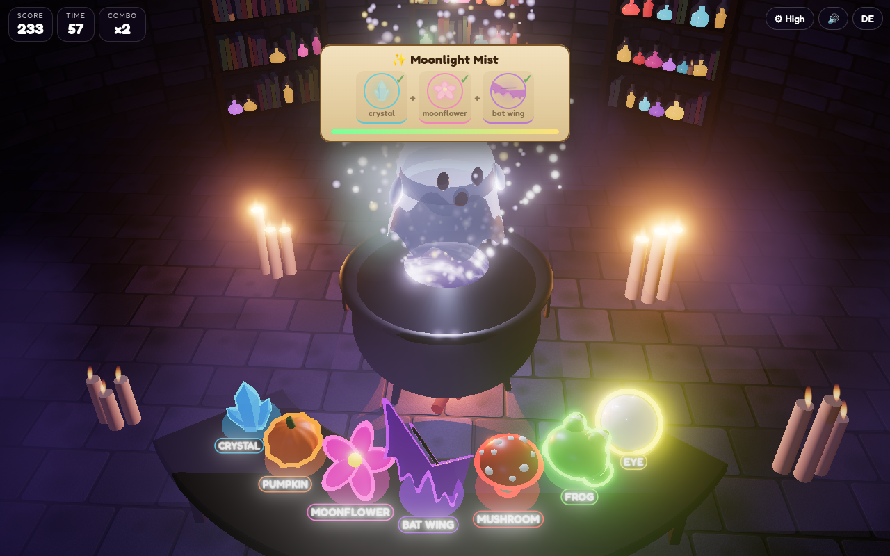

# 🧪 Potion Mixer

A cinematic 3D Halloween browser game. In a candle-lit witch's vault a big cauldron bubbles. Read the recipe, throw the ingredients in the right order, and watch a creature rise from the brew.

**Play:** https://frank-otto.github.io/potion-mixer/

## How to play (in 10 seconds)
- A **recipe card** shows three ingredients, e.g. eye + frog + moonflower.
- **Tap** an ingredient on the table (or **drag** it) to throw it into the cauldron, in the shown order.
- The right order: the brew changes color, sparks shoot up and a **ghost, a swarm of bats, the pumpkin king or the frog king** rises.
- A wrong ingredient makes the potion explode in goo and breaks the combo. After three wrong tries on the same recipe the next correct ingredient starts to glow as a hint (in kids mode the hints are always on).
- Every ingredient has its own shape, its own colour, a glowing outline and a name tag (EN/DE): eye (yellow), frog (green), mushroom (red), bat wing (violet), moonflower (pink), pumpkin (orange), crystal spire (cyan). The recipe card icons are rendered from the same 3D models. On phones the ingredients are drawn larger.
- Each recipe has a time limit that gets shorter. Brew potions in a row for a **combo** (up to ×5). A round lasts **60 seconds**.

Extras: English by default with a **DE** toggle, a **kids mode** (no timer, throw any three ingredients and discover 8 secret potions), a shareable **highscore card** (PNG, 1080×1350; the default name is "Player"), and **quality levels** (Low / Mid / High / Ultra; it steps down automatically if the frame rate drops).

## Tech
Three.js (WebGL): PBR materials, procedural stone textures with normal maps, an animated shader for the liquid surface, soft shadows, flickering candle lights, sprite steam and fog, GPU spark particles, bloom and (Ultra) depth of field. Bundled with esbuild into one classic script, so it runs straight from `file://`.

## Run locally
Open `index.html` directly (no server needed; on a Mac you can also double-click `start.command`). To rebuild after editing `src/`:
```
npm install && npm run build
```

## Tests
`python3 test/test_game.py` (Playwright + Chrome, headless WebGL): load without console errors, tap and drag, right order → creature and score, wrong order → goo and combo reset, recipe timeout, faster recipes, end screen after 60 s, PNG card size, DE toggle, kids mode, mobile tap, all quality levels, unique shape + colour + label per ingredient, recipe icons match the 3D items, solution hints only in kids mode (or after 3 wrong tries), larger ingredients on mobile.

## Credits
All sounds are recorded CC0 samples (see `LICENSES/SOUNDS.md`). Three.js (MIT). Font: Fredoka (SIL Open Font License 1.1).


